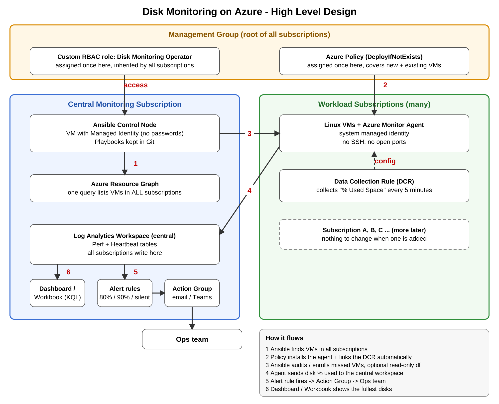

# Disk Monitoring for Azure VMs (Multi-Subscription) using Ansible

I chose **Azure** for this solution.
The goal: **find VMs that are running out of disk space early, before they cause downtime.**

The company already uses Ansible, so Ansible is the main tool. I only use Azure native
services (Azure Monitor, Log Analytics, Azure Policy) where they clearly save work.
No third-party monitoring product is needed.



_The diagram is also available as an editable draw.io file: `docs/architecture.drawio` (open it at https://app.diagrams.net)._

## 1. The idea in short

| Question | My answer |
|---|---|
| How do we reach VMs in many subscriptions? | Ansible uses a **Managed Identity** (no passwords) with a **custom least-privilege role** assigned once at the **Management Group**. All subscriptions inherit it. |
| How does Ansible talk to the VMs? | Through the **Azure control plane** (Run Command and Azure APIs). **No SSH, no keys, no open ports.** |
| How do we collect disk data? | **Azure Monitor Agent (AMA)** on each VM sends `% Used Space` every 5 minutes, controlled by a **Data Collection Rule (DCR)**. |
| How do VMs get enrolled? | **Azure Policy** (DeployIfNotExists) at Management Group installs the agent on every new and existing VM. Ansible audits and fixes anything missed. |
| Where do we see everything? | One central **Log Analytics workspace** + KQL queries / dashboard. |
| How do we get alerts? | **Log alert rules** (80% warning, 90% critical, VM silent) -> **Action Group** (email, Teams, ITSM). |
| How does it scale? | New subscription under the Management Group = automatic (role + policy are inherited). One alert rule covers all VMs. |

## 2. Why these choices

- **Why Managed Identity?** A password or service principal secret can leak or expire. A managed identity
  has no secret to store. The Ansible control node is simply an Azure VM with this identity.
- **Why a role at Management Group level?** If I give access per subscription, someone has to remember to do it for
  every new subscription (the company grows by acquisitions!). At Management Group it is inherited.
- **Why Azure Monitor Agent and not only Ansible running `df`?** `df` from Ansible is a snapshot only when the playbook runs.
  The agent gives continuous data, history, trends and alerts even if Ansible is down. I still include a `df` playbook for quick checks.
- **Why Azure Policy for enrollment?** Policy runs by itself. When someone creates a VM tomorrow in a new subscription,
  it gets the agent without any human step. Ansible is the safety net.
- **Why Azure Resource Graph?** One query lists VMs across *all* subscriptions in seconds. No need to loop over subscriptions one by one.
- **Why not Grafana / Datadog?** Leadership said use existing tools first. Azure Monitor is already available and needs no new servers.

## 3. Repo structure

```
.
├── README.md
├── docs/architecture.drawio          # architecture diagram (draw.io, editable)
├── docs/architecture.png             # same diagram as image
├── infra/
│   ├── main.bicep                    # Log Analytics, DCR, Action Group, alert rules (central)
│   ├── policy.bicep                  # Azure Policy at Management Group (auto-enrollment)
│   └── rbac-role.json                # custom least-privilege role for Ansible
├── scripts/bootstrap.sh              # one-time setup by an admin
├── tests/                            # offline test with a fake `az` command
├── kql/                              # queries for dashboard / workbook
│   ├── top_disks.kql
│   ├── days_until_full.kql
│   └── silent_vms.kql
└── ansible/
    ├── ansible.cfg
    ├── requirements.yml
    ├── inventory/settings.yml        # IDs, thresholds, Resource Graph queries
    └── playbooks/
        ├── 00_login_and_inventory.yml  # login with managed identity, count VMs per subscription
        ├── 01_enroll_vms.yml           # audit + fix VMs without agent
        ├── 02_disk_report.yml          # quick df via Run Command (no agent needed)
        ├── 03_top_disks.yml            # read fullest disks from Log Analytics
        └── tasks/enroll_one.yml
```

## 4. Key components

### 4.1 Access management
- **Identity:** a user-assigned Managed Identity attached to the Ansible control node. Ansible logs in with `az login --identity`.
- **Role:** `Disk Monitoring Operator` (`infra/rbac-role.json`) is a custom role with only what is needed:
  read subscriptions/VMs, query Resource Graph, install VM extensions, manage DCR associations and run a command.
  It is **assigned once at the Management Group**.
- **Log access:** the identity also gets the built-in `Log Analytics Reader` role on the central resource group only.
- **No network access needed:** Ansible never connects to the VM itself. All actions go through the Azure Resource Manager API,
  so there is no SSH, no NSG change, no VPN to every VNet.
- **Audit:** every action (extension install, run command, role use) shows in the Azure Activity Log.
- **Good practice:** use Privileged Identity Management (PIM) for the humans who can change this role, and keep the playbooks in Git with code review.

### 4.2 VM discovery and enrollment
- **Discovery:** Azure Resource Graph query in `settings.yml` lists all running Linux VMs across all subscriptions.
  No static inventory file.
- **Automatic enrollment:** `infra/policy.bicep` assigns two built-in Azure Policies at the Management Group:
  1. install **Azure Monitor Agent** (with system-assigned identity),
  2. associate the VM with our **DCR**.
  They apply to every new VM and can remediate existing VMs.
- **Safety net:** `01_enroll_vms.yml` finds running VMs that still have no agent (for example VMs that existed before the policy).
  Run it plain to see the gap, or with `-e enroll=true` to fix it.

### 4.3 Data collection and aggregation
- DCR (`infra/main.bicep`) collects `Logical Disk(*)\% Used Space` and `% Used Inodes` every 5 minutes into the `Perf` table.
- All subscriptions send to **one central Log Analytics workspace**, so the data is already aggregated.
- **Presenting:** KQL queries in `kql/` can be pinned to an Azure Dashboard or an Azure Workbook.
  - `top_disks.kql`: 20 fullest disks
  - `days_until_full.kql`: disks that will be full within 14 days (bonus)
  - `silent_vms.kql`: VMs that stopped reporting
- **Alerts** (all in `main.bicep`):
  - Warning at 80% (severity 2), Critical at 90% (severity 1)
  - "VM silent" alert, because a broken agent means we are blind
  - Alerts are split by VM and disk, and close themselves when the disk is healthy again.

### 4.4 Scalability
| Growth | What happens |
|---|---|
| New subscription | Put it under the Management Group. Role and Policy are inherited. Nothing else to do. |
| New VMs | Policy installs the agent. The same alert rules already cover them. |
| Many VMs | One alert rule covers all VMs (query based). Resource Graph handles thousands of VMs; use paging for more than 1000 results. |
| Many regions | The same DCR works for VMs in different regions. If data must stay in a region, create one workspace + DCR per region using the same Bicep. |
| Ansible load | Only used for audit and fixes, not for collection. It can run from CI on a schedule, or in parallel with `forks`. |
| Cost | Only 2 counters every 5 minutes keeps Log Analytics ingestion small. Retention is a parameter (30 days default). |

## 5. How to run (step by step)

1. **Admin (one time):** run the bootstrap script. It creates the central resources, the managed identity, the custom role and the policies.
   ```bash
   MG_ID=<management-group-id> CENTRAL_SUB=<subscription-id> ALERT_EMAIL=ops@example.com sh scripts/bootstrap.sh
   ```
2. Create the Ansible control node VM and attach the managed identity `id-ansible-disk-monitoring`.
3. On the control node:
   ```bash
   cd ansible
   pip install ansible
   ansible-galaxy collection install -r requirements.yml
   az extension add --name resource-graph
   az extension add --name log-analytics
   ```
4. Edit `inventory/settings.yml` (subscription id, DCR id printed by the bootstrap script).
5. Run:
   ```bash
   ansible-playbook playbooks/00_login_and_inventory.yml   # check access, count VMs
   ansible-playbook playbooks/01_enroll_vms.yml            # audit
   ansible-playbook playbooks/01_enroll_vms.yml -e enroll=true   # fix gaps
   ansible-playbook playbooks/02_disk_report.yml           # optional quick df
   ansible-playbook playbooks/03_top_disks.yml             # after ~10 minutes: see central data
   ```

